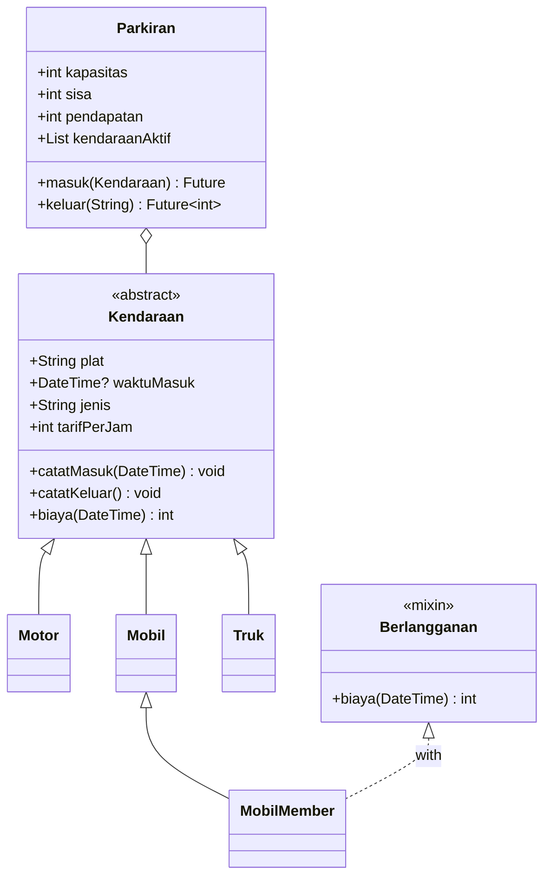
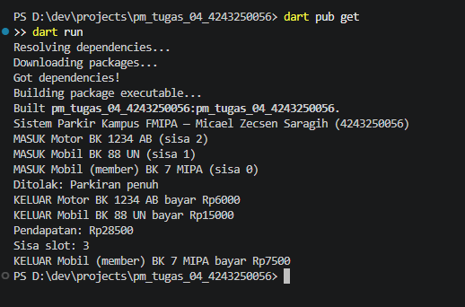
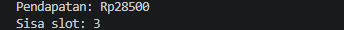
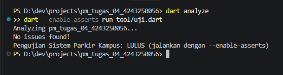

# Tugas Rutin 4 — Sistem Parkir Kampus (Console)

## Identitas Mahasiswa

| Atribut | Keterangan |
|---|---|
| **Nama** | Micael Zecsen Saragih |
| **NIM** | 4243250056 |
| **Kelas** | PSIK24D |
| **Universitas** | Universitas Negeri Medan |
| **Mata Kuliah** | Pemrograman Mobile |

## Sumber Materi

Modul Pertemuan 4 bagian D (halaman 21–22); slide OOP & Async Programming Pertemuan 4.

## Deskripsi

Program Dart console yang mensimulasikan sistem parkir area FMIPA dengan kapasitas terbatas, palang otomatis, kalkulasi biaya per jam, kendaraan member, dan notifikasi kejadian real-time ke pos jaga.

## Spesifikasi Wajib (dari Modul)

1. **Abstract class `Kendaraan`** — menyimpan plat dan waktu masuk, menetapkan getter `jenis` dan `tarifPerJam`, serta menghitung biaya dengan pembulatan ke atas (minimal 1 jam).
2. **Empat subclass** — `Motor`, `Mobil`, `Truk`, dan `MobilMember` dengan tarif berbeda; `MobilMember` menggunakan mixin `Berlangganan` untuk diskon 50%.
3. **Class `Parkiran`** — mengelola daftar kendaraan secara privat, menyediakan getter `sisa`, `pendapatan`, dan `kendaraanAktif`, serta melempar exception `ParkirPenuh` saat kapasitas habis.
4. **Async method `masuk()` dan `keluar()`** — menggunakan `Future.delayed` dan `await` untuk mensimulasikan proses palang otomatis.
5. **Stream log kejadian** — setiap kendaraan masuk atau keluar, pesan dikirim melalui `StreamController.broadcast()` dan diterima oleh listener pos jaga.
6. **Demo `main`** — menjalankan `List<Kendaraan>` berisi berbagai subtype, mencoba melebihi kapasitas, lalu menampilkan total pendapatan dan sisa slot.

## Diagram Kelas Sederhana



## Tarif Parkir

| Jenis Kendaraan | Tarif per Jam | Diskon Member |
|---|---|---|
| Motor | Rp 2.000 | — |
| Mobil | Rp 5.000 | — |
| Truk | Rp 8.000 | — |
| Mobil (member) | Rp 2.500 | 50% dari tarif Mobil |

Contoh: tiga jam parkir Motor, Mobil, dan Mobil Member menghasilkan Rp 6.000 + Rp 15.000 + Rp 7.500 = **Rp 28.500**.

## Cara Menjalankan

```powershell
dart pub get
dart run
```

Atau secara eksplisit:

```powershell
dart run bin/pm_tugas_04_4243250056.dart
```

## Pemeriksaan

```powershell
dart format .
dart analyze
dart --enable-asserts run tool/uji.dart
```

## Struktur Project

| Lokasi | Kegunaan |
|---|---|
| `bin/pm_tugas_04_4243250056.dart` | Demonstrasi lengkap sistem parkir |
| `lib/kendaraan.dart` | Abstract class, subclass Motor/Mobil/Truk, mixin Berlangganan |
| `lib/parkiran.dart` | Layanan parkir, exception ParkirPenuh, async, Stream |
| `tool/uji.dart` | Pengujian biaya, kapasitas, pendapatan, log |
| `docs/` | Screenshot bukti pengujian |

## Penjelasan OOP dan Async (100–200 kata)

**Enkapsulasi** diterapkan pada kelas `Parkiran` melalui daftar `_terparkir` dan angka `_pendapatan` yang hanya dapat diubah oleh layanan parkir. Kode di luar kelas memperoleh informasi melalui getter `sisa`, `pendapatan`, dan `kendaraanAktif` yang bersifat baca saja. Pada model kendaraan, waktu masuk disimpan secara privat dan diatur melalui method `catatMasuk()` dan `catatKeluar()` agar perubahan status lebih terkendali.

**Polimorfisme** terlihat dari penggunaan `List<Kendaraan>` yang berisi objek `Motor`, `Mobil`, dan `MobilMember`. Semua objek diproses melalui method yang sama, tetapi nilai `jenis`, `tarifPerJam`, dan `biaya()` mengikuti implementasi kelas masing-masing. Mixin `Berlangganan` menimpa perhitungan biaya untuk memberikan potongan 50 persen kepada kendaraan member.

**Async programming** digunakan pada method `masuk()` dan `keluar()` yang menunggu `Future.delayed` untuk menirukan proses palang otomatis. Keyword `await` mengatur urutan operasi tanpa pemblokiran sinkron. Setiap kendaraan masuk atau keluar, pesan dikirim lewat `StreamController.broadcast()` dan diterima oleh listener pos jaga, sehingga kegiatan parkir dan pemberitahuan dapat dipisahkan secara rapi.

## Bukti Screenshot

### Screenshot 1 — Kendaraan Masuk



Menampilkan tiga kendaraan berhasil masuk, log pos jaga via Stream, dan sisa kapasitas.

### Screenshot 2 — Kapasitas Penuh


Menampilkan percobaan Truk masuk ditolak karena kapasitas parkir sudah penuh (exception `ParkirPenuh`).

### Screenshot 3 — Kendaraan Keluar dan Pendapatan



Menampilkan biaya keluar tiap kendaraan, total pendapatan, dan sisa slot setelah kendaraan keluar.

### Screenshot 4 — Analisis dan Pengujian



Menampilkan hasil `dart analyze` bersih (no issues found) dan semua assertion pengujian lulus.

## Pengujian

Skrip `tool/uji.dart` memverifikasi:

- Biaya parkir untuk tiap jenis kendaraan (Motor, Mobil, Truk).
- Diskon 50% untuk `MobilMember`.
- Exception `ParkirPenuh` saat kapasitas terlampaui.
- Total pendapatan setelah beberapa kendaraan keluar.
- Log kejadian diterima melalui Stream.

Hasil pengujian: **LULUS** (tidak ada error, semua assertion terpenuhi).

## Pernyataan Penggunaan AI

ChatGPT digunakan untuk membantu merancang kode, dokumentasi, dan skrip pengujian. Mahasiswa bertanggung jawab membaca kode, menjalankan pengujian, mengumpulkan screenshot asli, dan memastikan hasil sesuai instruksi dosen.
