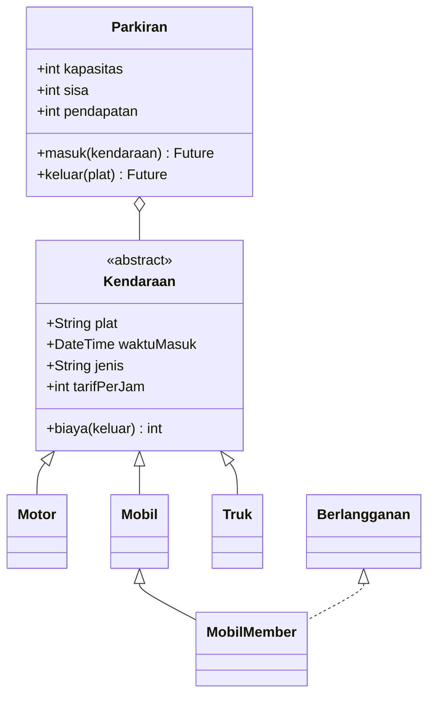

# Tugas Rutin 4 — Sistem Parkir Kampus (Console)

## Identitas

- **Nama:** Micael Zecsen Saragih
- **NIM:** 4243250056
- **Kelas:** PSIK24D
- **Universitas:** Universitas Negeri Medan
- **Mata kuliah:** Pemrograman Mobile

Sumber: Modul Pertemuan 4 bagian D, halaman 21–22; slide OOP & Async Programming.

## Deskripsi dan Fitur

Program Dart console mensimulasikan area parkir FMIPA dengan kapasitas terbatas, palang otomatis, kalkulasi biaya parkir, kendaraan member, dan kejadian langsung ke pos jaga.

1. `abstract class Kendaraan` menyimpan plat dan waktu masuk, menetapkan getter `jenis`/`tarifPerJam`, serta menghitung biaya per jam dengan pembulatan ke atas (minimal satu jam).
2. `Motor`, `Mobil`, `Truk`, dan `MobilMember` mengimplementasikan tarif berbeda. `MobilMember` memakai mixin `Berlangganan` untuk diskon 50%.
3. `Parkiran` menjaga daftar kendaraan privat, getter `sisa`/`pendapatan`, dan exception `ParkirPenuh` saat kapasitas habis.
4. `masuk` dan `keluar` memakai `Future.delayed`, dipanggil menggunakan `await`.
5. Log kejadian dikirim melalui `StreamController.broadcast()`.
6. `main` menjalankan `List<Kendaraan>` berisi berbagai subtype, mencoba melebihi kapasitas, kemudian menampilkan hasil pendapatan.

**Tarif latihan:** Motor Rp2.000/jam, Mobil Rp5.000/jam, Truk Rp8.000/jam, Mobil member Rp2.500/jam (diskon 50%). Nominal ini merupakan konfigurasi contoh karena modul tidak menentukan tarif baku. Sebagai contoh, tiga jam parkir Motor, Mobil, dan Mobil member menghasilkan Rp6.000 + Rp15.000 + Rp7.500 = **Rp28.500**.

## Diagram Kelas Sederhana



## Menjalankan

```powershell
dart pub get
dart run
```

Alternatif: `dart run bin/pm_tugas_04_4243250056.dart`.

## Pemeriksaan

```powershell
dart format .
dart analyze
dart --enable-asserts run tool/uji.dart
```

## Bukti Hasil (Screenshot)

Jalankan program dan simpan tangkapan layar asli ke folder `docs/`:

1. `docs/01-kendaraan-masuk.png` — tiga kendaraan masuk dan sisa kapasitas.
2. `docs/02-kapasitas-penuh.png` — percobaan Truk ditolak karena penuh.
3. `docs/03-keluar-pendapatan.png` — biaya keluar, total pendapatan, sisa slot.
4. `docs/04-analyze-uji.png` — hasil `dart analyze` dan skrip uji.

Setelah ada gambar, tambahkan tautan `` dan seterusnya.

## Penjelasan OOP dan Async (100–200 kata)

Enkapsulasi diterapkan pada kelas `Parkiran` melalui daftar `_terparkir` dan angka `_pendapatan` yang hanya dapat diubah oleh layanan parkir. Kode di luar kelas memperoleh informasi melalui getter `sisa`, `pendapatan`, serta `kendaraanAktif` yang bersifat tidak dapat dimodifikasi. Pada model kendaraan, waktu masuk disimpan secara privat dan diatur lewat method agar perubahan status lebih terkendali.

Polimorfisme terlihat dari penggunaan `List<Kendaraan>` yang berisi objek `Motor`, `Mobil`, dan `MobilMember`. Semua objek diproses melalui method yang sama, tetapi nilai `jenis`, `tarifPerJam`, dan `biaya()` mengikuti implementasi kelas masing-masing. Mixin `Berlangganan` menimpa perhitungan biaya untuk memberikan potongan 50 persen kepada kendaraan member.

Async programming digunakan pada method `masuk()` dan `keluar()` yang menunggu `Future.delayed` untuk menirukan proses palang otomatis. Keyword `await` mengatur urutan operasi tanpa pemblokiran sinkron. Setiap kendaraan masuk atau keluar, sebuah pesan dikirim lewat `StreamController.broadcast()` dan diterima oleh listener pos jaga. Dengan begitu, kegiatan parkir dan pemberitahuan dapat dipisahkan secara rapi.

## Struktur

| Lokasi | Kegunaan |
|---|---|
| `lib/kendaraan.dart` | Abstract class, subclass, mixin member |
| `lib/parkiran.dart` | Layanan parkir, exception, queue async, Stream |
| `bin/pm_tugas_04_4243250056.dart` | Demonstrasi lengkap |
| `tool/uji.dart` | Pengujian biaya, kapasitas, pendapatan, log |
| `docs/` | Screenshot bukti pengujian |

## Penggunaan AI

ChatGPT digunakan untuk membantu rancangan kode, dokumentasi, dan tes. Mahasiswa bertanggung jawab membaca kode, menjalankan pengujian, mengumpulkan screenshot asli, dan memastikan hasil sesuai instruksi dosen.
